# 忆境 Mnemo

[](LICENSE)


把 Obsidian 里的《记忆法全景手册》变成一个每天真的练一次的原生 iOS App。

- **必须先通过 Apple 登录**：打开 App 就是一条「通过 Apple 继续」，登录之后才看得到内容；不填注册表单，没有我们的服务器，姓名与邮箱只留在本机
- **数据存放可选**：登录后默认写进你自己的 iCloud（换设备登录同一个 Account 就能接着练），也可以在「我的 → 数据存储」切回本机；切换不删数据，另有可选的 4 位进入密码
- **每门方法都有三例看懂**：40 门方法 × 浅/中/深三份实例 = 120 份逐步示范，每份都按该方法自己的步骤走完（如图像记忆法：四个水果 → 项目四要素 → 十个朝代）
- **图解案例库（样板：图像记忆法）**：12 份真实材料 × 3 种记忆思路 = 36 条串法，分入门/进阶/高阶，图文对照 + 遮图自测
- **深夜 / 白天双主题**：所有颜色都是动态令牌，切换在「我的 → 外观」里，一点即时换肤（也可跟随系统），不重启、不丢当前页面
- 40 个记忆法知识库（自动从手册 + 儿童版抽取）
- 四大专项训练：词表闪记 / 数字桩 / 记忆宫殿 / 方法练习
- **九种题型 · 三阶练习**：概念配对、方法归类、步骤定位、原理溯源、材料适配、流程排除、步骤衔接、案例归属、应用编码（L1→L3）
- **学员等级 XP 体系**：答题得经验、升级换称号，题型推荐随等级自适应
- **智能推荐**：错题优先 → 到期复习 → 薄弱补练 → 冲星 → 开新法，按优先级排好
- **错题本 + 强化训练**：答错自动入库，重做答对两次出库，反复错的题优先
- **分学龄段闯关**：小学低年级翻翻配对 / 小学高年级排排队 / 初中限时抢答 / 高中编码工坊，45 关 × 三档，拿星解锁
- **目标计划**：每日/每周训练量、连续打卡、收星、正确率六类目标，可增删
- **学习报告**：本周 vs 上周、14 天训练量、正确率趋势、类别强弱、该补的方法
- **同级别排名**：离线模拟的同级参照榜（不上传任何数据）
- **学习日历**：按月展示每日训练强度，点开看当日明细
- **艾宾浩斯遗忘曲线**：保持率估算 + 9 节点复习阶梯 + SM-2 间隔重复排期
- 30 天训练计划、连续打卡、记忆精度 Lv.1–5、徽章

## 界面

| 登录 | 解锁 | 今日 | 训练场 |
| --- | --- | --- | --- |
| 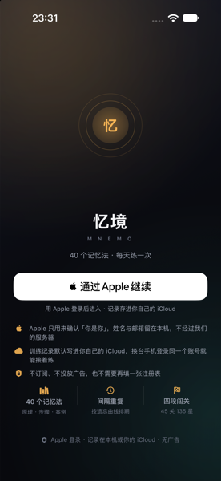 | 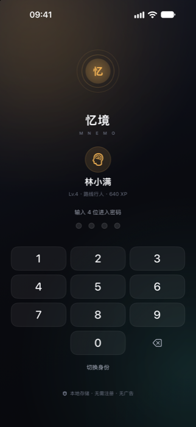 | 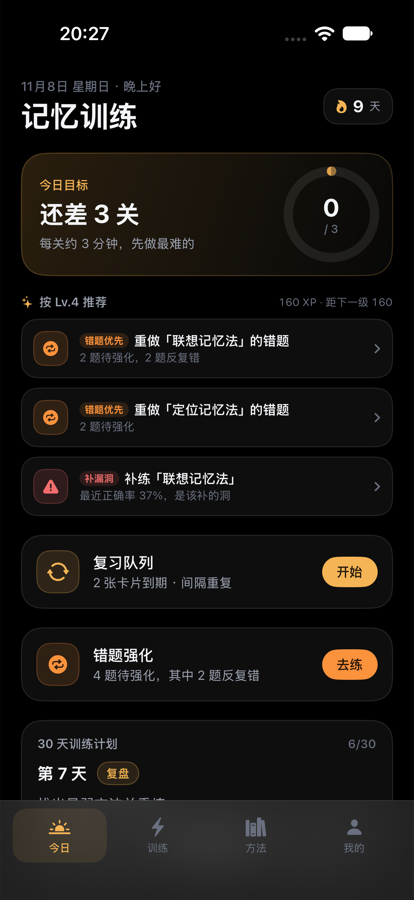 | 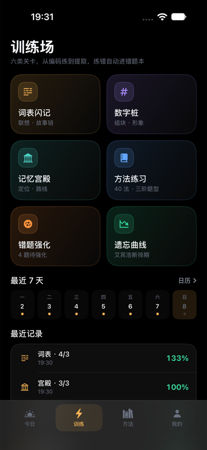 |

| 今日 | 训练场 | 方法库 | 我的 |
| --- | --- | --- | --- |
|  |  | 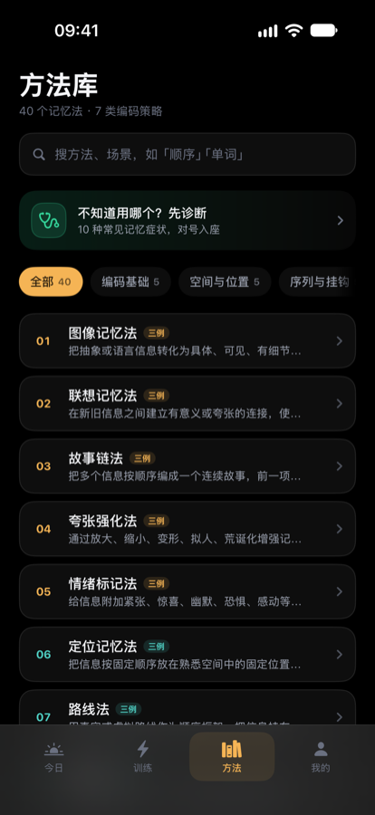 | 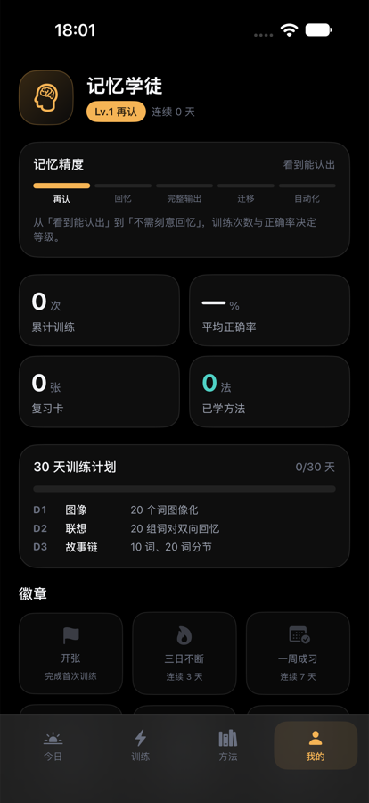 |

| 数据存储（我的 → 存储） |
| --- |
| 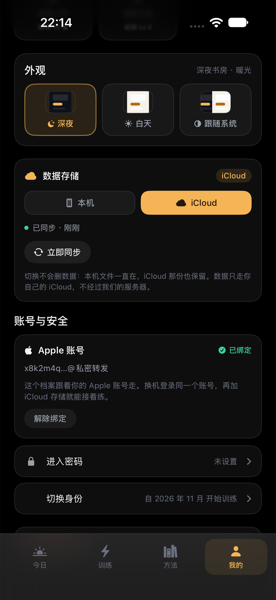 |

| 三例看懂（浅） | 三例看懂（中） | 图解案例 | 案例详情 |
| --- | --- | --- | --- |
| 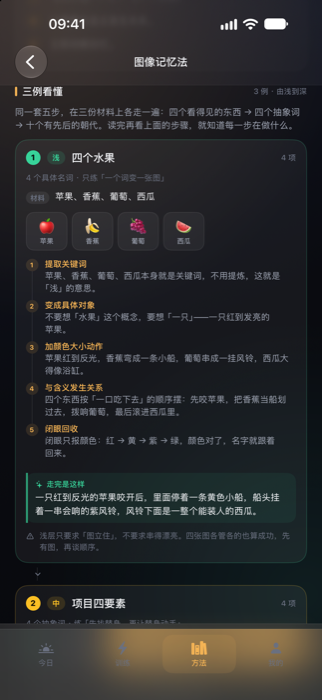 | 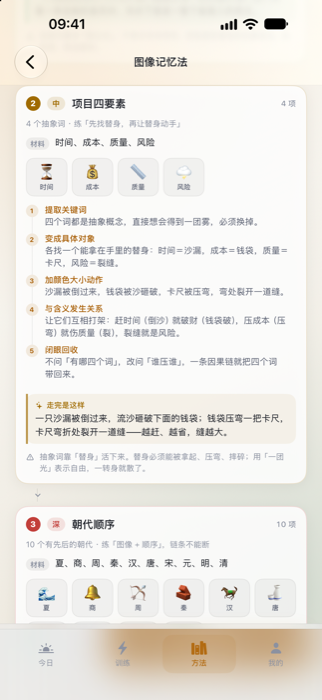 | 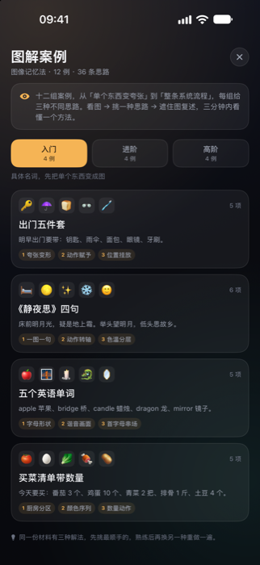 | 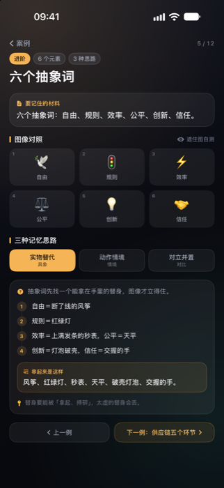 |

| 方法练习 | 错题强化 | 学习日历 | 遗忘曲线 |
| --- | --- | --- | --- |
| 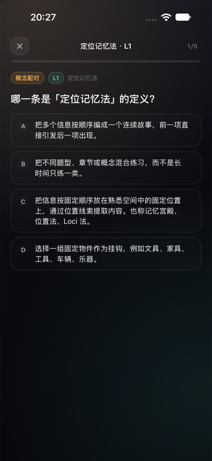 | 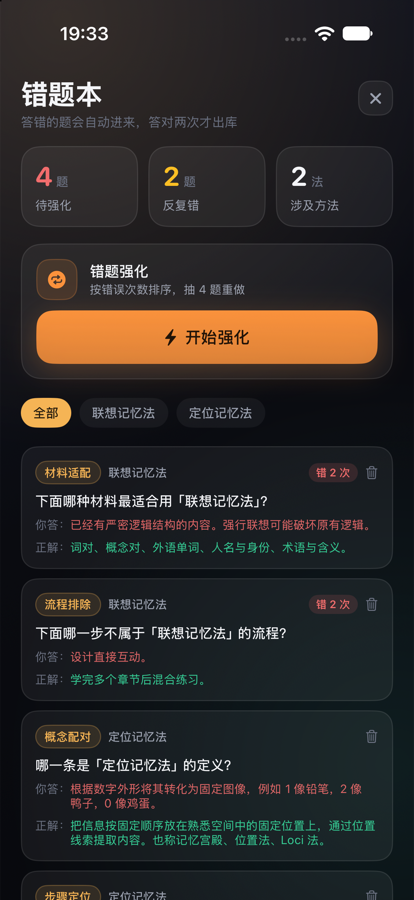 | 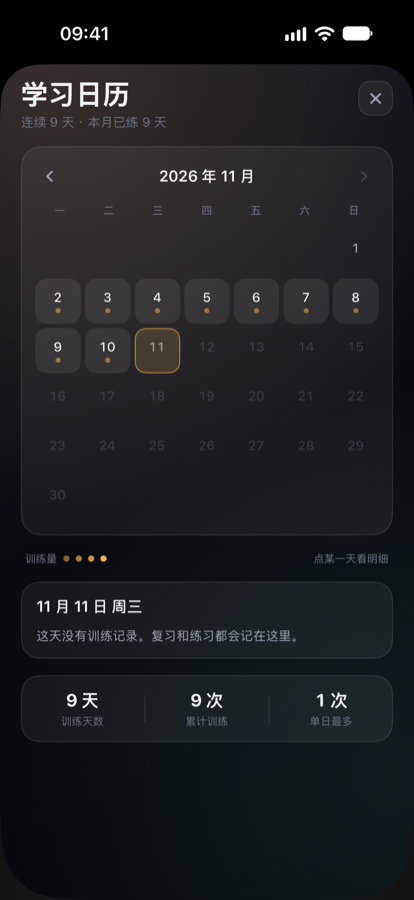 | 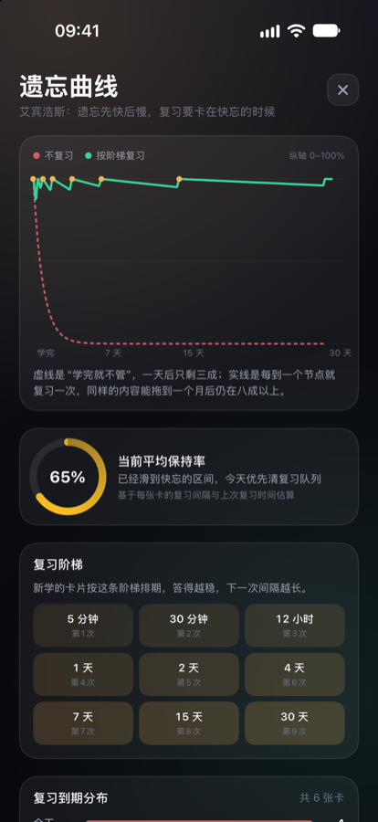 |

| 目标计划 | 学习报告 | 同级别排名 | 闯关结算 |
| --- | --- | --- | --- |
| 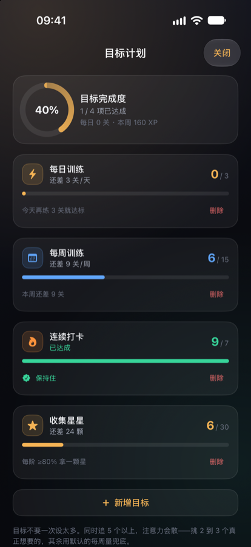 | 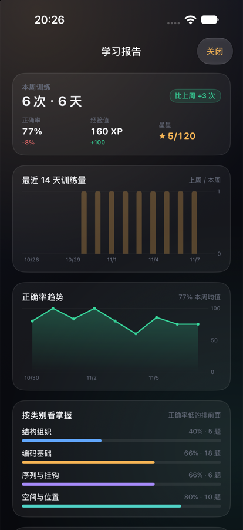 | 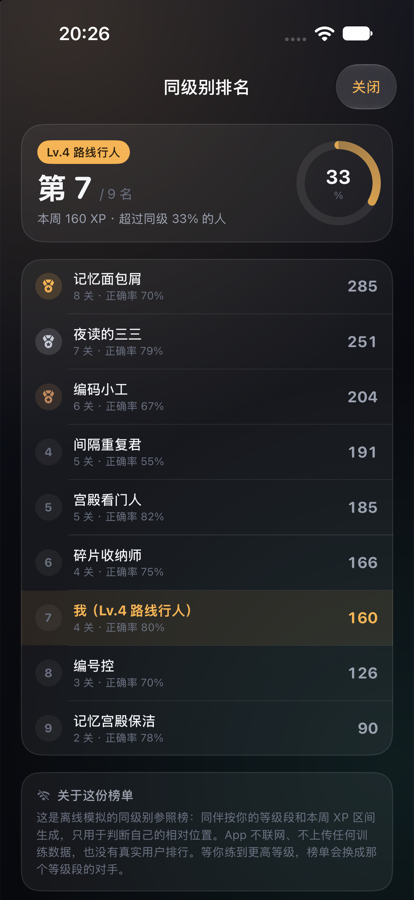 | 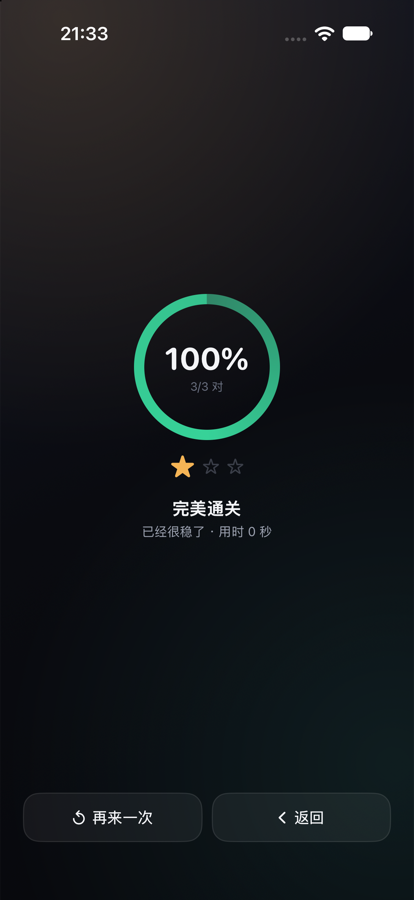 |

白天配色（同一套界面，纸感底 + 深琥珀）：

| 今日（白天） | 我的（白天） |
| --- | --- |
| 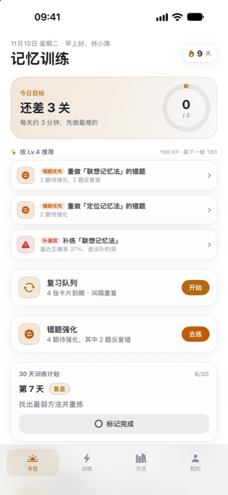 | 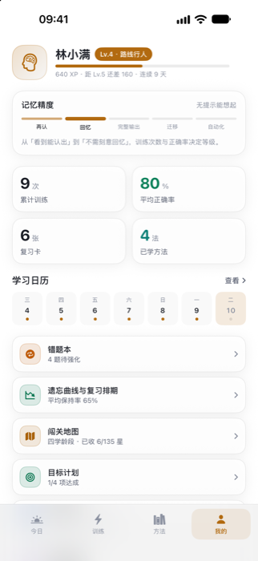 |

### 闯关：四个学龄段四套玩法

| 闯关地图 | 小学低年级 · 翻翻配对 | 小学高年级 · 排排队 | 初中 · 限时抢答 | 高中 · 编码工坊 |
| --- | --- | --- | --- | --- |
| 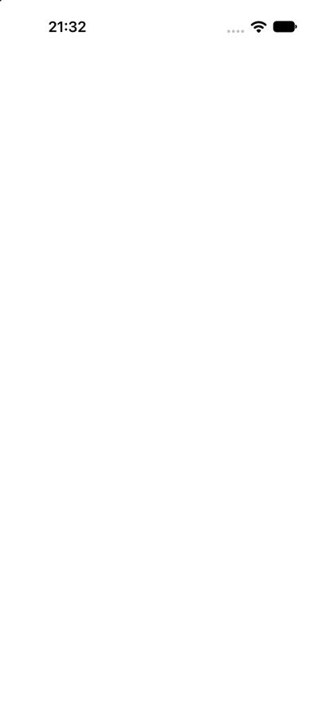 | 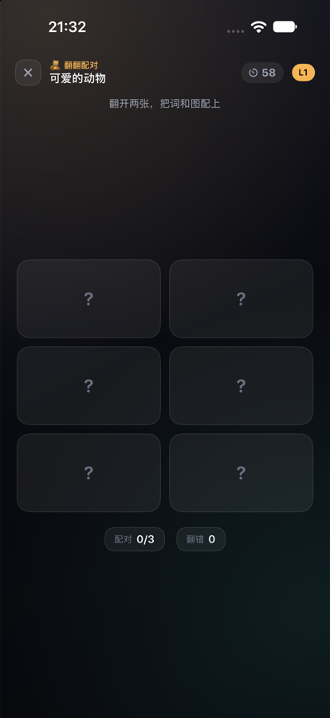 | 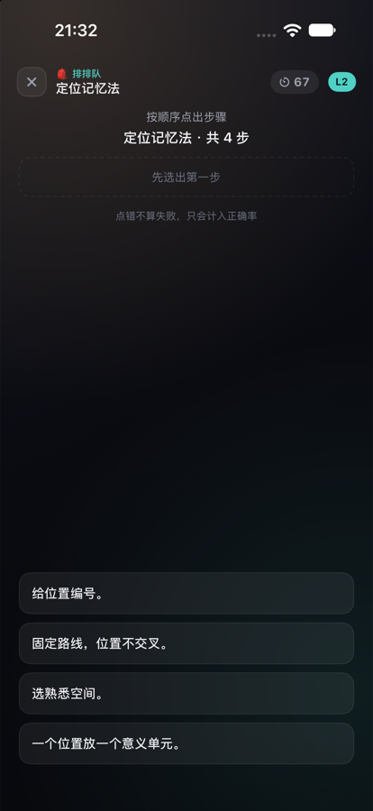 | 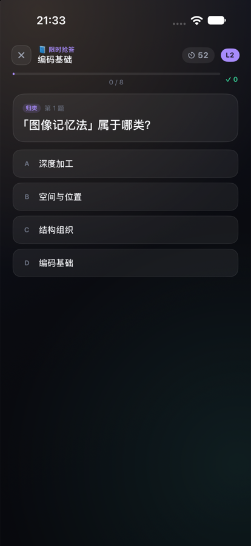 | 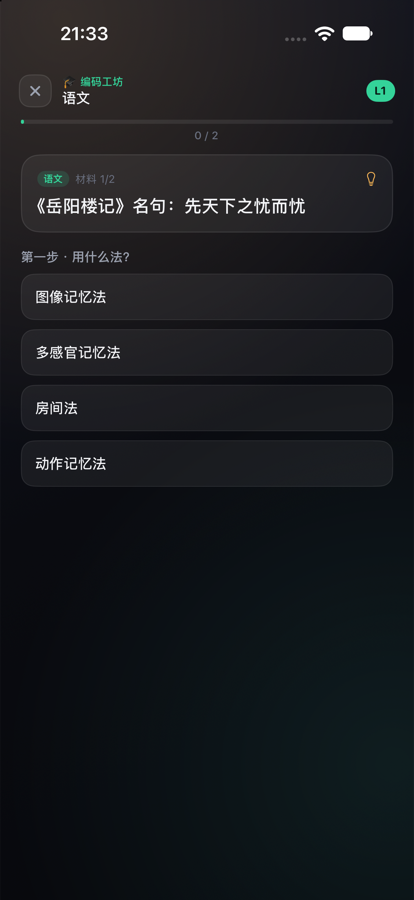 |

## 打开与运行

```bash
open Mnemo.xcodeproj        # Xcode 27，选 iPhone 模拟器直接 Cmd+R
```

命令行构建（推荐用脚本，原因见下）：

```bash
./Scripts/build.sh                       # 默认 iPhone 18 Pro
./Scripts/build.sh "iPhone 18"           # 指定模拟器
./Scripts/build.sh --install             # 构建 + 装到模拟器 + 启动
```

直接调 `xcodebuild` 的话，**必须**带上这两个参数：

```bash
xcodebuild -project Mnemo.xcodeproj -scheme Mnemo \
  -destination 'platform=iOS Simulator,name=iPhone 18 Pro' \
  -derivedDataPath build \
  SWIFT_USE_INTEGRATED_DRIVER=NO OTHER_SWIFT_FLAGS='$(inherited) -disable-sandbox' \
  build
```

> 为什么：Xcode 27 会给宏插件（`SwiftUIMacros` 等）单独起 `swift-plugin-server` 并套一层 `sandbox-exec` 沙箱。构建本身如果已经在受限 shell / CI 沙箱里，这层嵌套沙箱申请会被拒（`sandbox-exec: sandbox_apply: Operation not permitted`），插件返回 malformed response，所有 `@State` 展开失败，然后级联出上千条 `cannot assign to property: 'self' is immutable` —— 看着像代码写错了，其实和代码无关。Xcode GUI 里 Cmd+R 不走沙箱，不受影响。

安装到模拟器（`build.sh --install` 已包含）：

```bash
xcrun simctl boot "iPhone 18 Pro"
xcrun simctl install "iPhone 18 Pro" build/Build/Products/Debug-iphonesimulator/Mnemo.app
xcrun simctl launch "iPhone 18 Pro" com.tal.mnemo
```

## 发布

TestFlight 打包与上传：`./Scripts/release.sh`，账号侧准备见 [Docs/RELEASE.md](Docs/RELEASE.md)。
App Store 截图（6.9 英寸 1320×2868，共 10 张）：`./Scripts/screenshots.sh`，白天配色加 `THEME=day`，清单与上传说明见 [Docs/appstore/README.md](Docs/appstore/README.md)。

## 目录

```
Mnemo/
├── Mnemo.xcodeproj
├── Mnemo/
│   ├── MnemoApp.swift          入口
│   ├── Design/Theme.swift      视觉语言（颜色/卡片/触感）
│   ├── Models/
│   │   ├── Models.swift        方法/复习卡/统计/精度等级
│   │   ├── Practice.swift      九种题型/错题/每日统计/复习阶梯
│   │   ├── Game.swift          等级 XP/目标/推荐
│   │   └── Quest.swift         学龄段/关卡规格/四种玩法
│   ├── Data/
│   │   ├── AppStore.swift      状态与持久化、SM-2、出词
│   │   ├── AppStore+Practice.swift  出题引擎、错题结算、保持率
│   │   ├── AppStore+Game.swift      XP 结算、推荐、报告、排名
│   │   ├── AppStore+Quest.swift     闯关记星与解锁
│   │   └── QuestBank.swift     分学龄段题库组装
│   ├── Views/                  四 Tab + 15 个功能页 + 闯关四玩法
│   ├── Components/             进度环/按钮/胶囊等通用件
│   ├── Resources/
│   │   ├── methods.json        40 法知识库（Scripts/extract.py 生成）
│   │   ├── words.json          训练词库 110 词
│   │   └── quest.json          闯关题库（12 主题/12 方法/9 学科）
│   └── Assets.xcassets         App 图标
├── Scripts/
│   ├── build.sh                命令行构建（带宏沙箱修复参数）
│   ├── release.sh              归档 → 导出 → 上传 TestFlight
│   ├── screenshots.sh          App Store 截图批量生成
│   └── extract.py              文档 → JSON 抽取脚本（可重复运行）
└── Docs/
    ├── 记忆训练文档整理报告.md   文档整理结果
    ├── DESIGN.md               UI 与交互设计（v1→v7）
    ├── RELEASE.md              TestFlight 发布步骤
    ├── appstore/               App Store 截图（6.9 英寸）与上传说明
    └── screenshots/            各页面截图
```

## 演示模式

模拟器里想直接看到有数据的界面：

```bash
xcrun simctl launch "iPhone 18 Pro" com.tal.mnemo -seedDemo
```

会注入 9 天训练记录、6 张复习卡和 4 道错题（仅首次生效，重装可再来）。

## 更新内容

改完 Obsidian 文档后重新抽取即可：

```bash
python3 Scripts/extract.py
```

## 许可

MIT，见 [LICENSE](LICENSE)。
